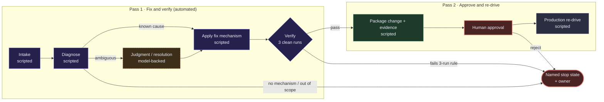

# A1 — Governed Multi-Agent Repair for Blocked Catalog Products

**Role:** Product Owner & Solution Architect · **Engagement:** A commerce/marketplace SaaS platform (AI-driven catalog) · **Period:** Jun 2026 – present
**Architecture type:** Lead-agent / worker-agent orchestration with a human-approved production path

> **Public-safe write-up.** Product names, internal tools, ticket keys, internal IDs, account names and third-party names are left out. Worker and state names are **generic labels** that show the shape of the design (which steps are scripted, which use a model, where the human decides). They are not the production identifiers. Every count comes from documented, independently evidenced work. This is a **scope-driven** case study: outcome metrics are still being collected while the engagement continues.

---

## 1. Context and forces

An AI-driven catalog engine takes sellers' raw product data and lists it on e-commerce marketplaces. Across a multi-thousand-item production catalog, products get **blocked**: a listing fails a downstream channel or quality rule and stops flowing. Each blocked product needs four things: someone has to find out why, choose a fix, check that the fix worked, and get the corrected product back into production.

An earlier piece of my work set this up: a standalone diagnostic tool that surfaces currently-blocked items straight from production fault telemetry, independent of the issue tracker, with safeguards against **over-crediting unverified fixes**. The repair architecture builds on that lesson. "Fixed" has to be proven, not assumed.

Several forces made this hard to automate safely:

- **Many failure causes, many fix mechanisms.** One generic "fix it" step can't cover them. Different causes need different kinds of repair.
- **Some steps have a provably correct answer and some need judgment.** If a model drives the whole loop, the deterministic steps become probabilistic. If everything is scripted, the ambiguous cases can't be handled.
- **Production re-drive is the risky step.** A wrong repair that reaches a live channel costs far more than a slow one.
- **Not every case belongs to automation.** Without clear ownership, cases outside the system's scope quietly stall.
- **Every change has to be auditable.** Reviewers need to see what was diagnosed, what was changed, what verified it and who approved it.

## 2. Decision

A **lead agent** delegates to **eight specialised workers** across **two workflow passes**:

- **Pass 1, Fix and verify (automated).** The lead agent diagnoses each blocked product, assigns a fix mechanism, routes the product to the right worker and verifies the repair. A repair counts as verified only after **three consecutive clean runs**.
- **Pass 2, Approve and re-drive (human-approved).** Verified repairs are packaged with their evidence. A person approves the package, and only then is the product re-driven to production.

Cases that automation shouldn't or can't resolve end in a **named stop state** with an **explicit owner** instead of being retried indefinitely.



## 3. Worker roster (genericized)

The design rule: **scripted workers handle deterministic work, and model-backed workers are limited to judgment and resolution steps.**

| # | Worker (generic label) | Pass | Type | Responsibility |
|---|---|---|---|---|
| 1 | Intake | 1 | Scripted | Collect blocked products and normalise their block reasons into one shape |
| 2 | Diagnoser | 1 | Scripted | Map a block reason to a known fix mechanism, or flag it as ambiguous or out of scope |
| 3 | Judgment worker | 1 | Model-backed | Classify ambiguous cases the diagnoser can't map deterministically |
| 4 | Resolver | 1 | Model-backed | Propose the repair content when a fix needs judgment, not just a rule |
| 5 | Fix applier | 1 | Scripted | Apply the assigned mechanism outside production |
| 6 | Verifier | 1 | Scripted | Re-run validation and enforce the three-clean-run rule |
| 7 | Packager | 2 | Scripted | Bundle the verified change, its diagnosis and verification evidence into one approval package |
| 8 | Re-driver | 2 | Scripted | Re-submit approved products to production and record the result |

The lead agent itself never edits a product. It routes products, tracks state and writes the audit trail.

## 4. Alternatives considered

| Option | Why not |
|---|---|
| **One general-purpose agent for the whole loop** | Deterministic steps become probabilistic and hard to test. One failure mode hides another, and it isn't clear who owns which errors. |
| **Fully scripted pipeline, no model** | Ambiguous diagnoses and judgment-based repairs either stall or get forced into the wrong mechanism. |
| **Single pass: fix, verify and re-drive automatically** | Removes the human check from the highest-risk step. One bad mechanism could reach live channels at scale before anyone noticed. |
| **Human review of every step** | Safe but doesn't scale, and reviewers would tire of approving deterministic steps that are already correct. The gate belongs only where the risk is. |
| **Single clean verification run** | Intermittent failures pass once and then fail in production. Three consecutive clean runs is a cheap guard against flaky repairs. |

## 5. Control boundaries

| Boundary | Rule |
|---|---|
| **Script vs model** | A model is used only where no deterministic answer exists (judgment and resolution). A model's output goes into a scripted worker before anything changes. |
| **Automated vs human** | Pass 1 never touches production. Only a human approval moves a package into Pass 2 re-drive. |
| **In vs out of automation** | Cases with no known mechanism, or outside the system's scope, leave through a named stop state with an explicit owner. They aren't retried indefinitely. |
| **Verification** | "Fixed" means three consecutive clean runs, not one. |

## 6. Contracts and handoff outcomes

Every worker hand-off uses the same envelope, so the lead agent and the audit trail can treat all eight workers alike:

```json
{
  "product_ref": "opaque-id",
  "worker": "diagnoser",
  "pass": 1,
  "input_digest": "sha256:…",
  "outcome": "ROUTED | VERIFIED | PACKAGED | APPROVED | REDRIVEN | STOPPED",
  "stop_state": null,
  "owner": null,
  "evidence": [{ "kind": "validation_run", "result": "clean", "run": 1 }],
  "rationale": "Short, human-readable reason for this outcome"
}
```

**Named stop states (generic labels):**

| Stop state | Entered when | Owner |
|---|---|---|
| `NO_MECHANISM` | Diagnosis finds no known fix mechanism | Named product/data owner |
| `OUT_OF_SCOPE` | The cause is outside what automation may change | Named owning team |
| `UNVERIFIED` | The repair fails the three-clean-run rule | Engineering owner of that mechanism |
| `REJECTED` | A human declines the Pass 2 package | Approver records the reason |

Each stop state is a **finished result with an owner**, not an error. That keeps the queue honest: every blocked product is either fixed, waiting for approval, or assigned to a named owner with a reason.

## 7. Risks and mitigations

| Risk | Mitigation in the design |
|---|---|
| A model-proposed repair is plausible but wrong | Model output only feeds a scripted fix applier, which must pass three clean verification runs and then a human approval |
| A flaky repair passes once | Three-consecutive-clean-run rule |
| A bad mechanism reaches production at scale | Production re-drive happens only after human approval of a packaged, evidenced change |
| Cases stall silently | Named stop states with explicit owners, so nothing is left unowned |
| No way to reconstruct what happened | Same handoff envelope for every worker, with an input digest, evidence and rationale per step |
| Reviewers tire of approving | Humans review only Pass 2 packages, not deterministic steps |

## 8. Scope evidence

- **8** worker roles defined, with deterministic and model-assisted responsibilities kept separate
- **2** workflow passes: automated fix verification, then human-approved production re-drive
- **3** consecutive clean runs required before a repair counts as verified
- Human-in-the-loop controls, named exceptions and auditable handoff contracts defined as part of the architecture

## 9. What I'd measure next

The engagement is ongoing, so these are being set up rather than estimated after the fact:

- Blocked products cleared per cycle, and median time from block to re-drive
- First-attempt verification pass rate (share meeting the three-clean-run rule first time)
- Share of cases closed by automation vs routed to each named stop state
- Human approval turnaround for Pass 2 packages, and rejection rate with reasons
- Repairs that later regressed after re-drive (the real test of the verification rule)

## Competencies shown

Solution architecture · agent orchestration · state-machine design · contract design · deterministic-vs-model control boundaries · human-in-the-loop governance · observability and auditability · risk control

**Decision records from this case study:** [ADR-001](../decisions/adr-001-two-pass-operating-model.md) · [ADR-002](../decisions/adr-002-script-vs-model-boundary.md) · [ADR-003](../decisions/adr-003-three-clean-run-verification.md) · [ADR-004](../decisions/adr-004-named-stop-states.md)
