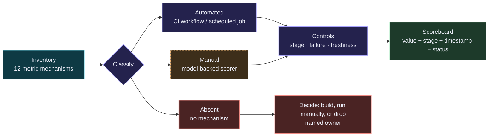

# A2 — Metrics Automation: CI vs Scheduled vs Manual Scorers

**Role:** Product Owner & Solution Architect · **Engagement:** A commerce/marketplace SaaS platform (AI-driven catalog) · **Period:** Jun 2026 – present
**Architecture type:** Assessment of metric-production mechanisms, with deployment and stage-isolation controls

> **Public-safe write-up.** Product names, internal tools, pipeline and job names, ticket keys, internal IDs and third-party names are left out. The comparison and the controls are written as **genericized design**. This is a **scope-driven** case study: it documents an assessment and its recommended controls, not measured outcomes.

---

## 1. Context and forces

A team scoreboard reported the quality metrics that delivery and prioritisation decisions depended on. Each metric was produced in its own way: some by CI workflows, some by scheduled jobs, some by a person running a model-backed scorer by hand, and some by nothing at all. Nobody had checked whether the number on the scoreboard was current, which environment it came from, or whether the job behind it had actually succeeded.

I had seen what bad metrics cost on this engagement before: a gap between "live-blocked" and "ever-blocked" counts that had to be reconciled before prioritisation could be trusted, and a contested quality target that needed a reproducible basis. This assessment applied the same scrutiny to the scoreboard as a whole.

Forces:

- **Different metrics need different mechanisms.** Deterministic counts suit automation. Judgment-based quality scores may need a model and a person.
- **Mechanisms fail in different ways.** A CI job, a scheduled job and a manual run each go wrong differently, and the scoreboard showed all three the same way.
- **Environments mix easily.** One metric can read from one stage and report as if it were another.
- **A green tick isn't proof.** A job that hides its own failure still looks healthy, and the scoreboard keeps showing the last value.
- **Old numbers look like new ones.** Without a timestamp, a months-old value reads as current.

## 2. Decision

Before automating anything further, **review every scoreboard metric mechanism**, classify it, and set a small number of controls that any mechanism must meet:

1. **Inventory and classify.** Review all **12** scoreboard metric mechanisms and classify each one as **automated**, **manual** or **absent**.
2. **Compare the options.** Assess CI workflows, scheduled jobs and manual model-backed scorers against freshness, reproducibility, stage isolation, failure visibility and cost.
3. **Name the failure patterns:** stage leakage, failure suppression and stale metrics.
4. **Document safe implementation choices** so new and migrated metrics follow one pattern instead of each inventing its own.

## 3. Comparing the options

| Criterion | CI workflow | Scheduled job | Manual model-backed scorer |
|---|---|---|---|
| **Runs when** | Code changes | On a clock | Someone remembers to run it |
| **Freshness** | Stale when data changes without a commit | Predictable, if the job succeeds | Least predictable |
| **Reproducibility** | High (versioned with the code) | High (versioned with the code) | Low unless prompt, model and sample are pinned |
| **Stage isolation risk** | Medium: CI context can point at the wrong environment | Medium: one schedule can serve several stages | High: run from a laptop against whatever is configured |
| **Failure visibility** | Good, unless the failure is suppressed | Poor by default: a failed run leaves the old value | None: a skipped run looks like no change |
| **Best fit** | Deterministic checks tied to a code change | Deterministic metrics over live data | Judgment-based quality scores that need a model and a person |

No single mechanism wins. The decision is to **match the mechanism to the metric**, then apply the **same controls to all of them**.

## 4. Failure patterns and controls

| Failure pattern | What it looks like | Control |
|---|---|---|
| **Stage leakage** | A metric computed against one environment stage is reported as another, or mixes data across stages | The stage is an **explicit input** to every metric job and is written next to the value. A job fails if the configured stage and the data's stage disagree. |
| **Failure suppression** | Error-swallowing patterns (ignore-errors flags, catch-all handlers, `continue-on-error`) make a failed metric run look green and leave the previous value on the board | Metric jobs **fail loudly**. A failed run writes a *failed* status for that metric instead of keeping the old value. |
| **Stale metrics** | A value with no timestamp keeps being shown long after its mechanism stopped running | Every value carries **computed-at time, source stage and mechanism**. The scoreboard flags a value as stale once it's older than that metric's freshness window. |

**Manual scorers** also need: a pinned prompt and model version, a recorded sample, and a named person who runs them on a stated cadence. If those can't be met, the metric is reported as *manual — last run on <date>*, never as current.

**Absent metrics** need a decision, not a placeholder: build a mechanism, run it manually with an owner, or remove it from the scoreboard.

## 5. Alternatives considered

| Option | Why not |
|---|---|
| **Automate everything in CI now** | CI runs on code change, not data change, so CI-only metrics go stale between commits. Automating first also locks in the existing stage and failure problems. |
| **Move everything to one scheduler** | Fixes freshness but not stage leakage or hidden failures, and has no good place for judgment-based scorers. |
| **Keep manual scorers as they are** | Not reproducible and invisible when skipped. The scoreboard can't tell "unchanged" from "not run". |
| **Remove judgment-based metrics** | Leaves out the quality signals the team most needed. The fix is to govern the manual runs, not drop them. |

## 6. Control boundaries

| Boundary | Rule |
|---|---|
| **Stage** | Stated explicitly, never inferred. A mismatch fails the run. |
| **Success vs failure** | A failed run is reported as failed and never shown as the last good value. |
| **Fresh vs stale** | Each metric has a freshness window, and the scoreboard shows when it has passed. |
| **Automated vs manual** | Manual, model-backed scoring is allowed only with pinned inputs, a named runner and a visible last-run date. |

## 7. Risks and mitigations

| Risk | Mitigation |
|---|---|
| Decisions made on a number from the wrong environment | Stage recorded with every value; mismatch fails the run |
| A broken metric job goes unnoticed for weeks | No failure suppression; failed status replaces the value |
| Old values treated as current | Timestamp plus freshness window; stale flag on the scoreboard |
| Manual scores drift between runs | Pinned prompt, model and sample; named runner |
| Over-automating before metric definitions are sound | Inventory and classify first; definitions reconciled before automation |

## 8. Scope evidence

- **12** scoreboard metric mechanisms reviewed and classified as automated, manual or absent
- **3** automation options compared: CI workflows, scheduled jobs, manual model-backed scorers
- **3** failure patterns identified: stage leakage, failure suppression, stale metrics
- Safe implementation choices documented for new and migrated metrics

## 9. What I'd measure next

- Share of scoreboard metrics with stage, timestamp and status recorded
- Share of metrics inside their freshness window at any given time
- Metric job failures detected vs previously hidden (once suppression is removed)
- Time from a metric breaking to someone noticing
- Number of absent metrics resolved (built, made manual with an owner, or removed)

## Competencies shown

Systems analysis · CI/CD architecture · environment-stage isolation · data observability · operational risk · implementation trade-off analysis

**Decision records from this case study:** [ADR-005](../decisions/adr-005-stage-is-explicit.md) · [ADR-006](../decisions/adr-006-metric-jobs-fail-loudly.md) · [ADR-007](../decisions/adr-007-freshness-is-part-of-the-metric.md)
