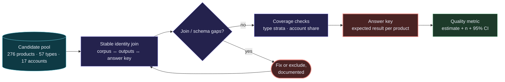

# A3 — Designing a Defensible End-to-End Quality Metric

**Role:** Product Owner & Solution Architect · **Engagement:** A commerce/marketplace SaaS platform (AI-driven catalog) · **Period:** Jun 2026 – present
**Architecture type:** Corpus, answer-key and data-join design for an end-to-end quality measurement

> **Public-safe write-up.** Product names, account names, internal tools, table and field names, ticket keys and third-party names are left out. Counts come from documented, independently evidenced work. The margin-of-error figures are standard arithmetic on those counts, shown to explain the design. This is a **scope-driven** case study: it documents the design of the measurement, not a measured quality result.

---

## 1. Context and forces

The catalog engine takes sellers' raw product data and turns it into marketplace listings across several pipeline stages. The team needed **one end-to-end quality number**: of the products that go in, how many come out correct? A number like that only helps if it holds up when someone challenges it. On this engagement I had already seen a quality target disputed because it had no reproducible basis, so the metric had to be defensible before it was built.

A quality metric depends on two things: the **corpus** (which products are measured) and the **answer key** (what "correct" means for each one). Getting either wrong produces a precise-looking number that means nothing.

Forces:

- **Product identity isn't stable by default.** The same product can appear under different identifiers across pipeline stages and re-runs. Join on the wrong key and the answer key attaches to the wrong output.
- **The candidate pool is wide and thin.** 276 candidate products spread across 57 product types and 17 accounts averages fewer than 5 products per type.
- **Accounts aren't evenly represented.** If a few accounts dominate the corpus, the metric describes those sellers, not the platform.
- **A single number hides its own uncertainty.** "82% correct" means very different things at n = 30 and n = 300.
- **Schemas drift.** Fields the answer key depends on may be missing, renamed or differently populated at different stages.

## 2. Decision

Set out the **data joins and statistical coverage requirements** before building the metric:

1. **Stable product identity.** Join the corpus, pipeline outputs and answer key on an identity that survives stages and re-runs, never on a per-run identifier.
2. **Confidence intervals are part of the result.** Report every quality figure with its sample size and 95% confidence interval.
3. **Stratify by product type.** Build the corpus to cover the range of product types instead of sampling whatever is most common.
4. **Measure account concentration.** Track how much of the corpus each account contributes, and report it with the metric so one seller can't silently set the platform number.
5. **Close join and schema gaps first.** Any gap that would misjoin or drop products is fixed or explicitly excluded before the metric goes live.

## 3. Why the statistics shape the design

Worst-case 95% margin of error for a proportion (p = 0.5), by sample size:

| Sample | What it represents | ± margin (95%) |
|---|---|---|
| 276 | Full candidate pool | ≈ ±5.9 points |
| 100 | A large sub-group | ≈ ±9.8 points |
| 30 | A small sub-group | ≈ ±17.9 points |
| ~5 | Average products per type (276 ÷ 57) | ≈ ±44 points |

Two design consequences follow:

- **The headline number is usable; per-type numbers are not.** At around 5 products per type, a per-type percentage is mostly noise. Stratification is there to make the **overall** number representative, not to produce 57 separate scores.
- **Changes have to be bigger than the interval to count.** A movement of 2–3 points on the headline number is inside the margin and shouldn't be reported as an improvement or a regression.

## 4. Coverage requirements

| Dimension | Requirement | Why |
|---|---|---|
| **Product identity** | Every corpus product resolves to one stable identity across stages | Prevents the answer key matching the wrong output |
| **Product type** | Corpus spans the product-type range, not only the most common types | Keeps the headline number representative |
| **Account** | Each account's share of the corpus is measured and reported | Stops one seller's data from setting the platform score |
| **Sample size** | n and 95% CI reported with every figure | Makes the uncertainty visible |
| **Schema** | Fields the answer key depends on are present at every stage measured | Prevents silent drops and misjoins |

## 5. Alternatives considered

| Option | Why not |
|---|---|
| **Measure whatever recent products are easiest to pull** | Over-represents common types and high-volume accounts, so the number describes the biggest sellers |
| **Join on per-run identifiers** | Breaks when products are re-ingested or re-run, attaching expected results to the wrong outputs |
| **Report per-type quality scores** | At ~5 products per type the intervals are too wide to mean anything |
| **Report a single percentage without an interval** | Invites reading noise as progress and reopens the "where does this number come from" dispute |
| **Build the metric first, fix data gaps later** | The first published number would be wrong, and a wrong first number is hard to retract |

## 6. Risks and mitigations

| Risk | Mitigation |
|---|---|
| Expected results attached to the wrong product | Stable identity join; misjoins treated as gaps to fix or exclude |
| Metric dominated by a few accounts | Account share measured and reported with the metric |
| Noise reported as progress | n and CI with every figure; no per-type scores |
| Products silently dropped by schema gaps | Gaps found and resolved or explicitly excluded before launch |
| The number is disputed later | Corpus, answer key and join logic documented so the figure can be reproduced |

## 7. Scope evidence

- **276** candidate products evaluated across **57** product types and **17** accounts
- Data joins and statistical coverage requirements defined: stable product identity, confidence intervals, product-type stratification, account concentration
- Join and schema gaps found that could otherwise have produced misleading metrics

## 8. What I'd measure next

- Share of corpus products that resolve to one stable identity across all stages measured
- Headline quality estimate with n and 95% CI, tracked over releases
- Largest single-account share of the corpus, and how the metric changes without that account
- Number of join and schema gaps open vs resolved
- Agreement between independent reviewers on a sample of answer-key entries

## Competencies shown

Data architecture · quality-measurement design · answer-key design · statistical validation · technical scoping

**Decision records from this case study:** [ADR-008](../decisions/adr-008-stable-product-identity.md) · [ADR-009](../decisions/adr-009-report-with-confidence-intervals.md) · [ADR-010](../decisions/adr-010-stratify-and-report-concentration.md)
