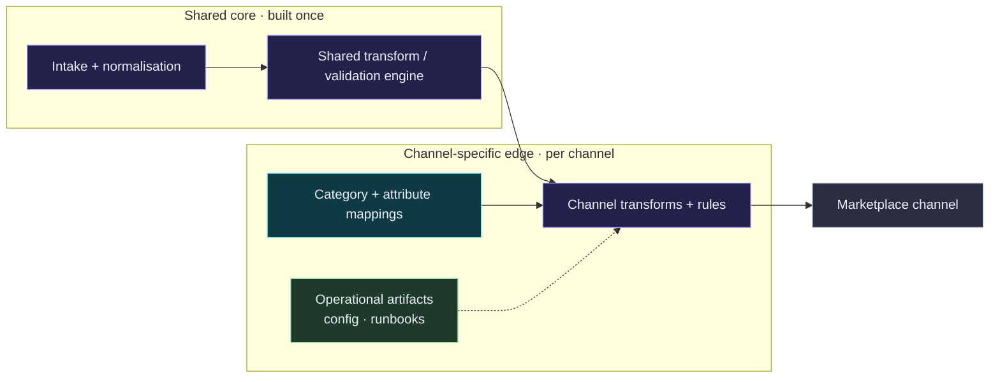

# A4 — Reusable Channel Onboarding for a Marketplace Pipeline

**Role:** Product Owner & Solution Architect · **Engagement:** A commerce/marketplace SaaS platform (AI-driven catalog) · **Period:** Jun 2026 – present
**Architecture type:** Integration architecture RFC, with a shared core, channel-specific edges and a per-category rollout loop

> **Public-safe write-up.** Marketplace and channel names, product names, internal tools, repository and file names, ticket keys and third-party names are left out. The 25 artifact types are described by layer; the examples given are **genericized**. This is a **scope-driven** case study: it documents the RFC and its reference classification, not a measured rollout.

---

## 1. Context and forces

The platform's transformation pipeline turns sellers' product data into listings that each marketplace channel accepts. Each channel has its own categories, attributes and rules. Supporting a new sales channel meant working out which parts of an existing channel's implementation could be reused, which had to be rebuilt, and in what order to bring categories live.

This RFC built on two earlier pieces of my work on the engagement:
- a channel-bootstrap RFC with category-classification research, which settled classification ambiguity before the build started
- category-mapping validation for existing marketplace channels: **8+ review packets covering hundreds of SKUs**

Forces:

- **Copying a whole channel is the easy path.** A full copy duplicates logic that should be shared, so the next bug fix has to be made twice and the copies drift apart.
- **Not everything is code.** Mappings, transforms, validation rules, configuration, scripts and runbooks all make a channel work. They need to be classified before anyone can say what is reusable.
- **Runtime and tooling have different risk.** An artifact the pipeline runs in production carries more risk than one an engineer uses to prepare or check it.
- **Channels go live one category at a time.** Turning on a whole channel at once makes it hard to tell which category caused a problem.
- **Classification ambiguity is costly late.** If product-to-category classification is unclear, the build stalls or gets redone.

## 2. Decision

Extend the pipeline to the new channel using a **shared core with channel-specific edges**, and bring it live through a **repeatable per-category rollout loop**:

1. **Separate shared from channel-specific.** Shared capabilities stay in one place. Each channel supplies only its own mappings, transforms and operational artifacts.
2. **Classify every artifact.** Use an existing channel as the reference implementation and classify its artifacts by layer: **11 runtime** and **14 tooling** artifact types.
3. **Roll out per category.** Each product category goes through the same loop: map, validate, enable, monitor. Then the next category starts.
4. **Settle classification first.** Product-to-category classification questions are resolved before category work starts, not discovered during it.

## 3. Artifact classification

The reference implementation's artifacts were sorted on two axes: **runtime vs tooling**, and **shared vs channel-specific**.

| Layer | Count | What it covers (genericized examples) | Reuse rule |
|---|---|---|---|
| **Runtime** | 11 types | What the pipeline executes for a channel, e.g. category mappings, attribute transforms, validation rules, channel configuration | Shared engine reused as is; channel-specific runtime artifacts authored new for each channel |
| **Tooling** | 14 types | What engineers use to build, check and operate a channel, e.g. mapping-preparation scripts, validation and review-packet generators, test fixtures, runbooks | Templated once; each channel fills in its own instance |

**Why both axes matter:** "runtime vs tooling" sets the level of review and testing. "Shared vs channel-specific" sets what a new channel has to build. An artifact that is both runtime and shared gets the most scrutiny, because a change to it affects every channel.

## 4. The per-category rollout loop

| Step | What happens | Exit criterion |
|---|---|---|
| **1. Select** | Pick the next category by seller demand and mapping readiness | Category classification settled |
| **2. Map** | Author category and attribute mappings for the channel | Mapping complete for the category's required attributes |
| **3. Validate** | Review a validation packet of real SKUs against the mapping | Packet reviewed; failures fixed or accepted with an owner |
| **4. Enable** | Turn the category on for the channel | Listings flowing |
| **5. Monitor** | Watch blocks and rejections for that category | Stable, then return to step 1 for the next category |

Each loop is small enough to roll back, and every problem can be traced to one category.

## 5. Alternatives considered

| Option | Why not |
|---|---|
| **Fork an existing channel wholesale** | Fastest first channel, slowest every channel after: duplicated logic, drift, and fixes made more than once |
| **Generalise everything into the shared core** | Pushes channel quirks into shared code, so every channel pays for every other channel's rules |
| **Enable the whole channel at once** | Problems can't be traced to a category, and rolling back means turning off the whole channel |
| **Start building, resolve classification as it comes up** | Classification surprises mid-build cause rework, which the earlier bootstrap research was designed to avoid |

## 6. Control boundaries

| Boundary | Rule |
|---|---|
| **Shared vs channel-specific** | Channel rules live at the edge. The shared core changes only for something every channel needs. |
| **Runtime vs tooling** | Runtime artifacts get production-grade review and tests. Tooling follows templates. |
| **Category gate** | No category is enabled without a reviewed validation packet. |
| **Classification** | Category classification is settled before mapping starts. |

## 7. Risks and mitigations

| Risk | Mitigation |
|---|---|
| Channel logic drifts into the shared core | Edge-first rule; shared-core changes reviewed as affecting every channel |
| A bad mapping reaches live listings | Validation packet per category before enablement |
| A problem can't be traced to its source | One category per loop; monitor before moving on |
| A new channel rebuilds tooling from scratch | 14 tooling artifact types templated from the reference implementation |
| Classification ambiguity stalls the build | Resolved up front, following the earlier bootstrap research |

## 8. Scope evidence

- **1** RFC defining how the transformation pipeline extends to a new sales channel
- **11** runtime and **14** tooling artifact types classified for a reference implementation
- Repeatable per-category rollout loop defined
- Builds on an earlier channel-bootstrap RFC and **8+** category-mapping validation packets covering hundreds of SKUs

## 9. What I'd measure next

- Time to bring a category live on the new channel, first category vs later ones
- Share of artifacts reused from templates vs authored new, per channel
- Validation-packet failure rate per category, and how many failures were caught before enablement
- Post-enablement block and rejection rate per category
- Shared-core changes needed per new channel (lower means the edges are holding)

## Competencies shown

Integration architecture · extensibility · migration planning · technical documentation (RFC) · implementation trade-offs

**Decision records from this case study:** [ADR-011](../decisions/adr-011-shared-core-channel-edges.md) · [ADR-012](../decisions/adr-012-classify-runtime-and-tooling.md) · [ADR-013](../decisions/adr-013-per-category-rollout.md)
